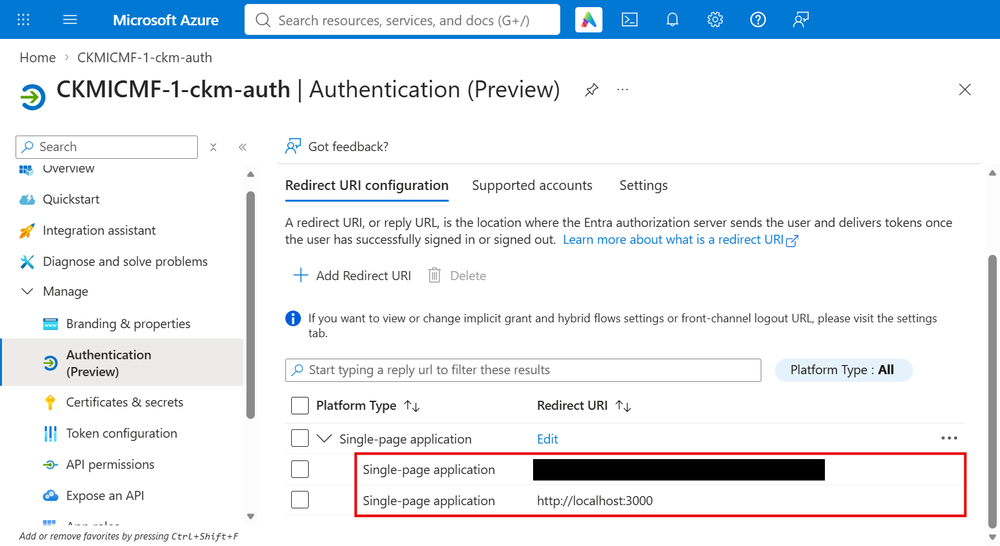
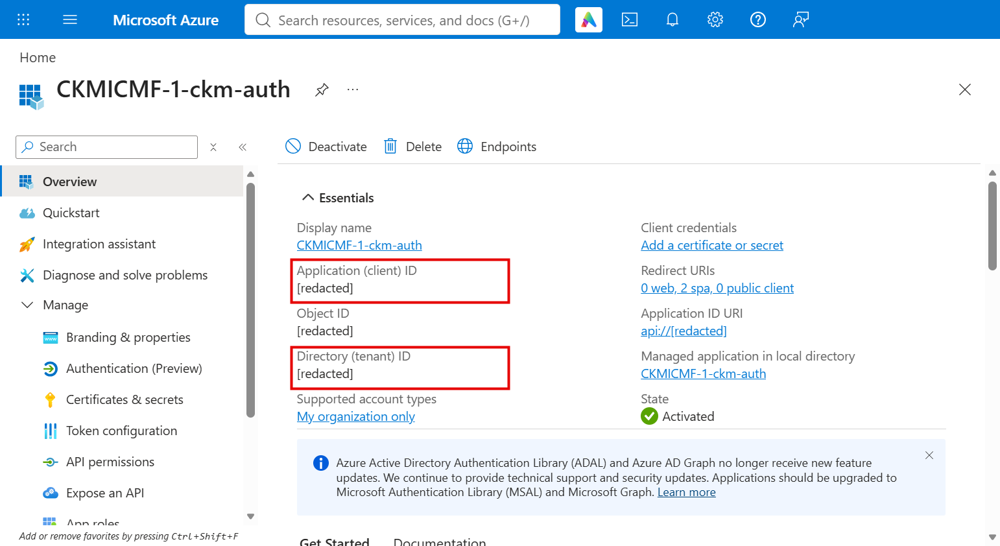
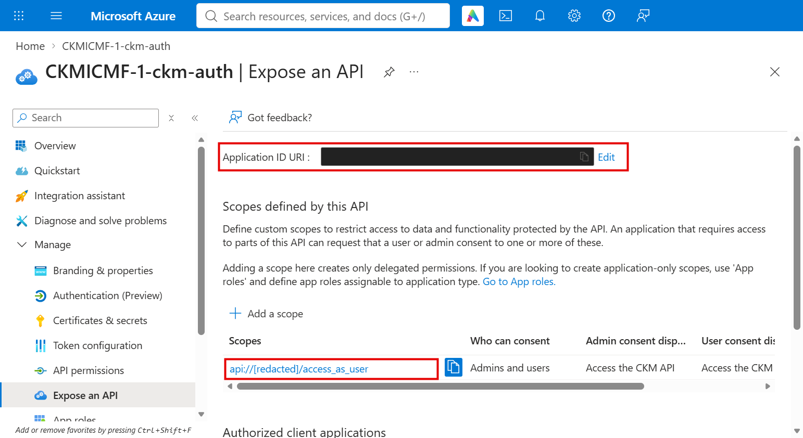
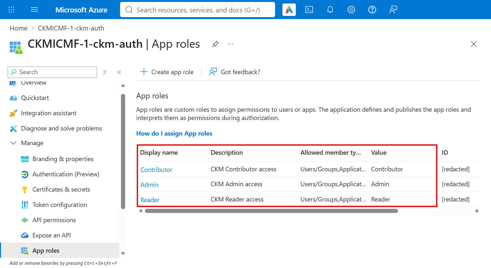

# Create a New App Registration

Create a single-tenant registration for the MSAL frontend and protected API.
See [authentication configuration](./AppAuthentication.md) for scopes and roles.

The screenshots show an existing example deployment with directory IDs redacted.
For normal `azd up` deployments, use them to verify the automated configuration;
manual registration is an alternative, not an additional required step.

## Prerequisites

- Permission to create app registrations in **Microsoft Entra ID**
- The **Default domain** URL of your deployed frontend App Service

## Steps

1. Go to the [Azure Portal](https://portal.azure.com/) and navigate to **Microsoft Entra ID**.

2. In the left menu, select **App registrations**, then click **+ New registration**.

3. Configure the registration:
   - **Name:** e.g., `conversation-knowledge-mining`
   - **Supported account types:** Accounts in this organizational directory only (single tenant)
   - **Redirect URI:** Select **Single-page application (SPA)** and enter:
     ```
     https://<your-frontend-app>.azurewebsites.net
     ```

   For an existing registration, verify these settings under **Authentication**
   (which may be labeled **Authentication (Preview)**). The deployed frontend
   and local development redirect URIs must use **Single-page application**.

   

4. Click **Register**.

5. From the app registration **Overview** page, copy the **Application (client) ID** and **Directory (tenant) ID** — you will need these values.

   

6. Under **Expose an API**, set `api://<client-id>` and create the delegated
   `access_as_user` scope. Configure consent to this API permission.

   

7. Set `api.requestedAccessTokenVersion` to `2` in the manifest and configure
   `Reader`, `Contributor`, and `Admin` app roles. Do not create a browser client secret.

   

   Defining roles does not assign users. Follow the
   [role assignment instructions](./AppAuthentication.md#automated-deployment-setup)
   after deployment.

## Reference the App Registration

Set `AZURE_AD_TENANT_ID` and `AZURE_AD_CLIENT_ID` before deployment as described
in [authentication configuration](./AppAuthentication.md).

## Next Steps

Return to the [Deployment Guide](./DeploymentGuide.md#54-configure-authentication-required) to continue.
